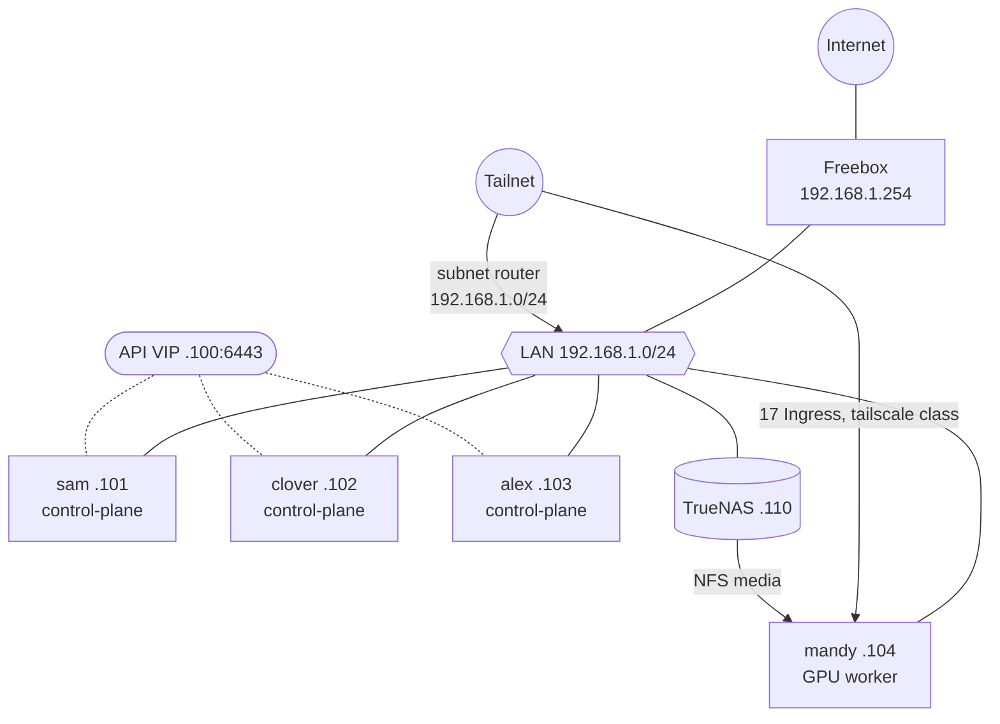
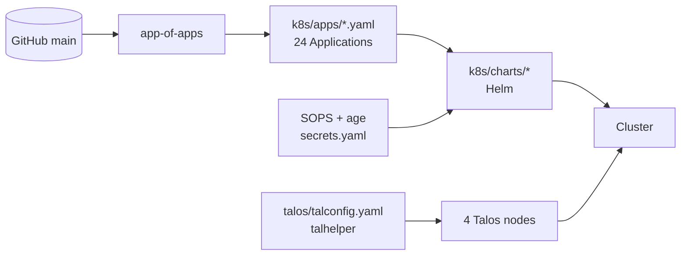
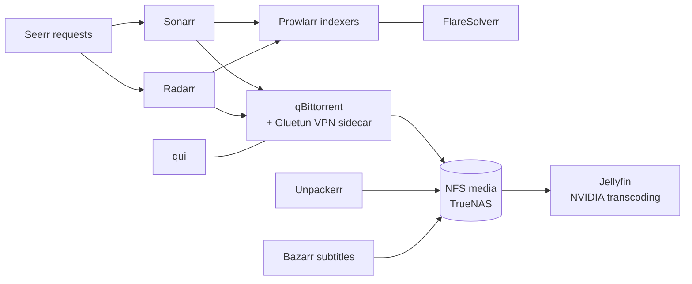
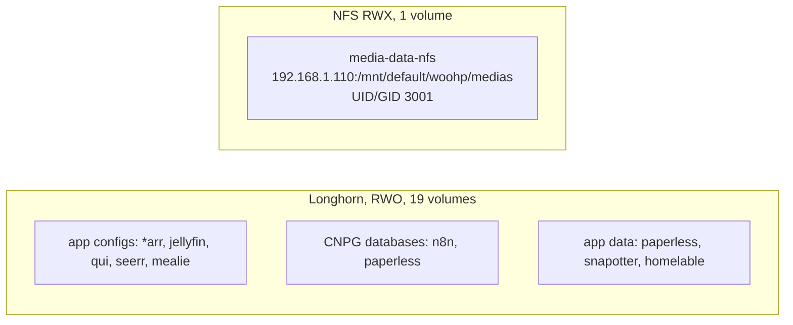

# Homelab audit and mapping (2026-10-22)

Snapshot of the woohp cluster, collected read-only with `kubectl` and `talosctl` plus a Homelable LAN scan. The repo is public: unidentified LAN devices are deliberately left out.

## At a glance

| | |
|---|---|
| Nodes | 4 (3 control-plane + 1 GPU worker) |
| Capacity | 16 vCPU, about 43 GiB RAM |
| OS / Kubernetes | Talos v1.14.1 / Kubernetes v1.37.1 |
| ArgoCD applications | 24 (+ `app-of-apps`) |
| Pods | 122 |
| Tailscale Ingress | 17 |
| Volumes | 19 Longhorn (RWO) + 1 NFS (RWX) |

## Nodes

| Node | IP | Role | RAM usage | CPU usage | Pods |
|---|---|---|---|---|---|
| sam | 192.168.1.101 | control-plane + etcd | 88% | 11% | 24 |
| clover | 192.168.1.102 | control-plane + etcd | 65% | 11% | 26 |
| alex | 192.168.1.103 | control-plane + etcd | 65% | 9% | 26 |
| mandy | 192.168.1.104 | worker, NVIDIA GPU, 23 GiB | 41% | 25% | 46 |

The Kubernetes API is served on the Talos VIP `192.168.1.100:6443`. Control-plane nodes also run workloads.

## Network and access

Every web UI is reachable only through Tailscale (`ingressClassName: tailscale`). A `Connector` (`lan-subnet-router`) advertises the LAN to the tailnet. No service is exposed publicly.

## GitOps layers

A merged commit is the deploy: ArgoCD auto-syncs with prune and self-heal.

## Media stack

## Storage

## Findings

| Severity | Finding | Suggested action |
|---|---|---|
| Medium | `sam` is at 88% memory while `mandy` is at 41%. | Move workloads (for example paperless) toward `mandy`, or add RAM. |
| Medium | `mandy` runs 46 pods, hosts the GPU, 6 of 12 media pods and most Tailscale proxies. It is a single point of failure for media. | Document recovery, or add a second worker. |
| Medium | Every app runs one replica. | Accept for a homelab, or add replicas for the few apps that matter. |
| Low | `AGENTS.md` lists 3 nodes and Talos v1.13.6 / Kubernetes v1.36.2. The cluster has 4 nodes on Talos v1.14.1 / Kubernetes v1.37.1. | Update `AGENTS.md` and `talconfig.yaml` notes. |
| Low | Longhorn replica count and backup target were not audited. | Check `kubectl get settings.longhorn.io -n longhorn-system`. |
| Info | Homelable runs in its own `privileged` namespace because its scanner needs `NET_RAW`. | Keep it isolated. |
